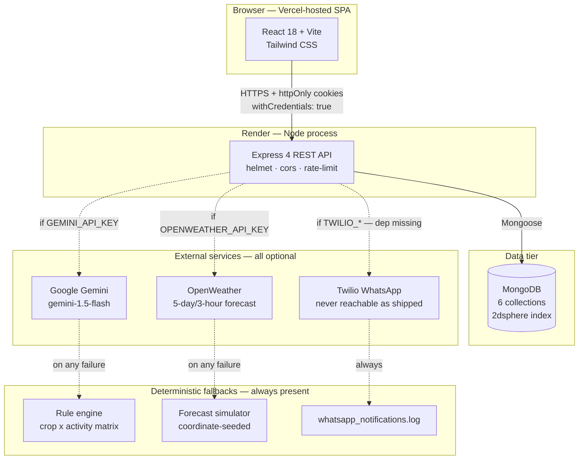
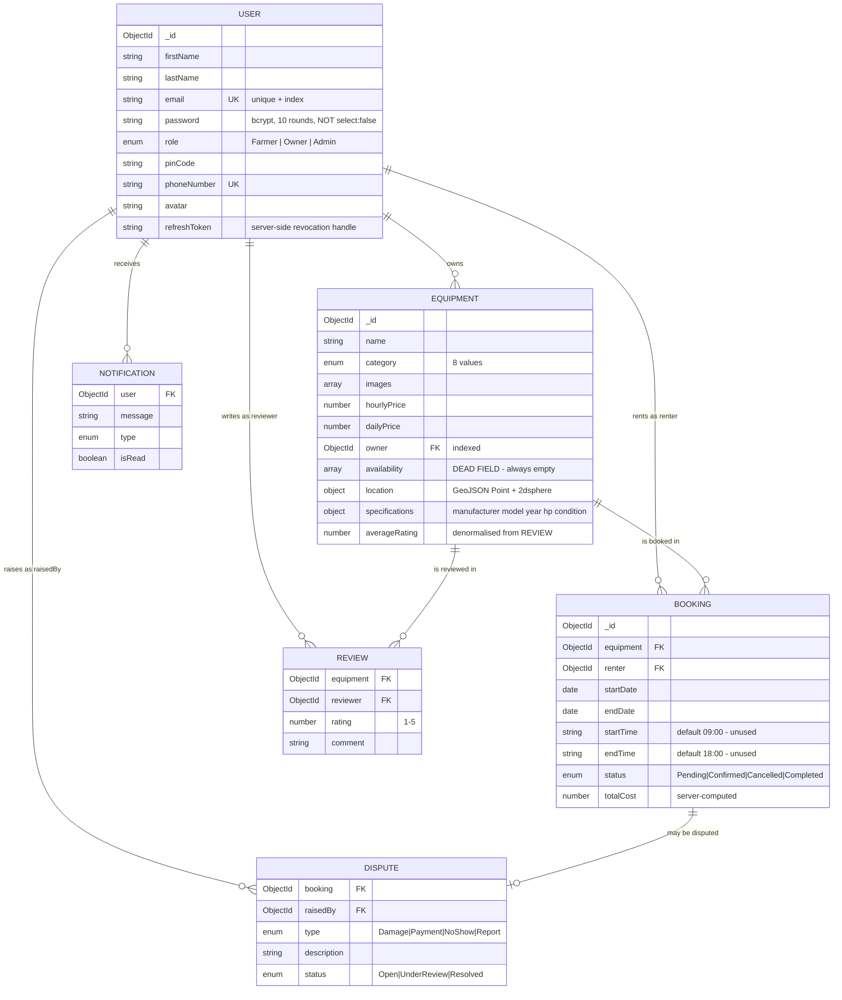
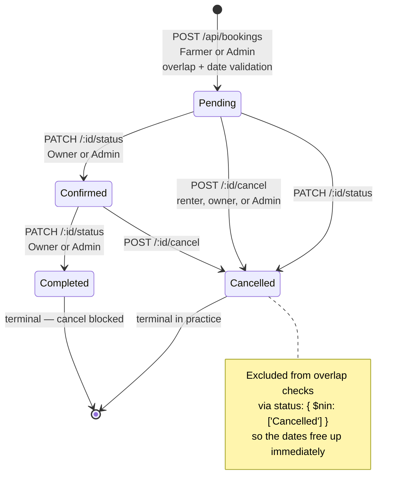
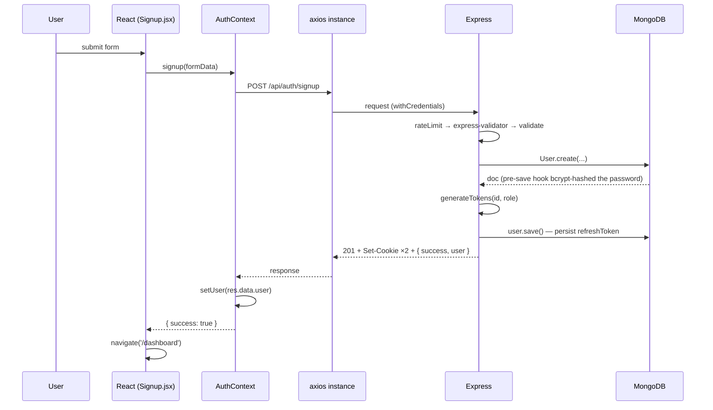
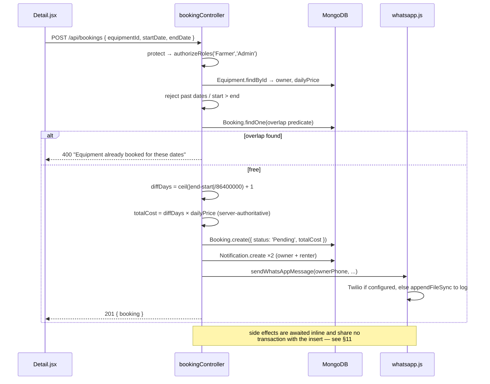

# AgriShare AI — End-to-End Architecture & Implementation Guide

A complete technical walkthrough of the AgriShare AI farm-equipment rental platform: what it does, how every layer is built, how requests flow end to end, where the design is strong, and where it is weak.

**Document status:** derived by reading every source file in `backend/` and `frontend/` at commit `f98c92f`. Every claim below is traceable to code, not to the README.

---

## 0. How to read this document

| If you want to… | Read |
| --- | --- |
| Understand the product in 60 seconds | §1 |
| Know exactly what libraries and versions are used | §2 |
| See the whole system on one page | §3 |
| Trace the backend layer by layer | §5 |
| Trace the frontend layer by layer | §6 |
| Follow a real request from click to database | §7 |
| Know what is broken or risky | §11 — read this before any interview |
| Talk about scaling it | §12 |

A companion file, `INTERVIEW_QUESTIONS.md`, turns all of this into a question bank.

---

## 1. What the system does

AgriShare AI is a **two-sided rental marketplace for agricultural machinery** in India. Its own README pitches it as "Airbnb + Uber + OLX for Farm Equipment."

The economic problem it targets is asymmetric asset utilisation. A tractor or combine harvester costs lakhs of rupees and sits idle most of the year, while small and marginal farmers who cannot justify the capital outlay still need the machine for a two-week window during land preparation or harvest. AgriShare brokers that window.

**Three actors, enforced as roles in the database:**

- **Farmer** — searches listings, books equipment, receives AI equipment recommendations, cancels bookings, leaves reviews, files reports.
- **Owner** — lists machinery with specifications and pricing, approves or rejects incoming booking requests, marks rentals complete, tracks earnings.
- **Admin** — sees platform-wide analytics, a regional demand heatmap, and a disputes queue.

**What makes it more than a CRUD marketplace** — four "intelligence" features layered on top:

1. **AI equipment recommendation.** Given crop, acreage, and farming activity, the system returns which implements to rent, for how many days, at what daily rate, and why. Backed by Google Gemini, with a deterministic rule engine as fallback.
2. **Weather-aware operational advisories.** A 5-day forecast is scored for farming suitability (0–100) and converted into concrete machine-level advice — for example, "delay rotavator operations, wet soil causes severe compaction." Backed by OpenWeather, with a deterministic simulation as fallback.
3. **Dynamic price estimation.** A base category rate is adjusted by a regional demand multiplier derived from live booking density, then reduced by a volume discount, and returned as an itemised receipt with an explanation string.
4. **Demand heatmap and analytics.** Bookings are aggregated by pincode and category to show owners and admins where demand concentrates.

**Plus two accessibility features that matter for the target user:** WhatsApp notifications (the dominant messaging channel among Indian farmers) and a four-language UI — English, Hindi, Kannada, Telugu.

---

## 2. Technology inventory

Exact versions, read from the two `package.json` files.

### Backend — `agrishare-ai-backend`

| Concern | Package | Version | Role in this codebase |
| --- | --- | --- | --- |
| Runtime | Node.js | 18+ | CommonJS modules throughout (`require`, not `import`) |
| HTTP framework | `express` | ^4.19.2 | Routing, middleware pipeline |
| ODM | `mongoose` | ^8.4.0 | Schemas, validation, hooks, aggregation, geospatial index |
| Password hashing | `bcryptjs` | ^2.4.3 | 10 salt rounds, in a `pre('save')` hook |
| Tokens | `jsonwebtoken` | ^9.0.2 | Access + refresh + password-reset tokens |
| Cookies | `cookie-parser` | ^1.4.6 | Reads `httpOnly` auth cookies |
| CORS | `cors` | ^2.8.5 | Single-origin allowlist with credentials |
| Security headers | `helmet` | ^7.1.0 | Default header set, no custom CSP |
| Abuse control | `express-rate-limit` | ^7.2.0 | 100 requests / 15 min, `/api/auth` only |
| Input validation | `express-validator` | ^7.1.0 | Declarative rules in route definitions |
| LLM client | `@google/generative-ai` | ^0.11.4 | `gemini-1.5-flash` |
| HTTP client | `axios` | ^1.7.2 | OpenWeather calls |
| Config | `dotenv` | ^16.4.5 | `.env` loading |
| Tests | `jest` + `supertest` | ^29.7.0 / ^7.0.0 | 4 integration tests |
| Dev loop | `nodemon` | ^3.1.2 | `npm run dev` |

**Notable absence:** `twilio` is `require`d at runtime inside `utils/whatsapp.js` but is **not** declared as a dependency. If Twilio credentials are ever set, the `require` throws `MODULE_NOT_FOUND`, which the surrounding `try/catch` swallows, silently falling through to the log-file simulation. WhatsApp delivery is therefore mock-only in every environment as shipped.

### Frontend — `agrishare-ai-frontend`

| Concern | Package | Version | Role |
| --- | --- | --- | --- |
| UI library | `react` / `react-dom` | ^18.3.1 | Function components + hooks only, no class components |
| Build tool | `vite` | ^5.2.11 | Dev server + Rollup production build |
| Routing | `react-router-dom` | ^6.23.1 | `BrowserRouter`, nested `Routes`, `useSearchParams` |
| HTTP client | `axios` | ^1.7.2 | Single configured instance + response interceptor |
| Styling | `tailwindcss` | ^3.4.3 | Utility classes, `darkMode: 'class'`, custom `brand` palette |
| Icons | `lucide-react` | ^0.395.0 | Every icon in the UI |
| CSS pipeline | `postcss` + `autoprefixer` | ^8.4.38 / ^10.4.19 | Tailwind compilation |
| Linting | `eslint` + React plugins | ^8.57.0 | `--max-warnings 0` |

**Notable absences on the frontend:** no state library (Redux/Zustand), no data-fetching library (React Query/SWR), no form library (Formik/RHF), no charting library, and **no map library** — despite `GOOGLE_MAPS_API_KEY` appearing in `.env.example`. Charts are hand-built `div` bars; the map is a hand-built SVG. This is a deliberate zero-dependency-creep choice, and it has real consequences discussed in §6.5 and §11.

---

## 3. Architecture at a glance

### 3.1 System context



The dotted edges are the defining architectural characteristic of this system: **every external dependency is optional and has a deterministic local substitute.** The application never returns an error because a third party is down, over quota, or unconfigured. This is what lets the project be cloned and demoed with zero API keys.

### 3.2 Layered view (ASCII)

```
┌───────────────────────────────────────────────────────────────────────────┐
│ PRESENTATION                                                              │
│   10 pages · 5 shared components · 2 React contexts                       │
│   Home  Search  Detail  Login  Signup  Dashboard→{Farmer|Owner|Admin}     │
│   AiHub                                                                   │
│   Navbar  Footer  ProductCard  WeatherWidget  MapViewer                   │
└──────────────────────────────┬────────────────────────────────────────────┘
                               │ axios instance, baseURL=…/api
                               │ withCredentials, 401→refresh→retry
┌──────────────────────────────▼────────────────────────────────────────────┐
│ EDGE / MIDDLEWARE          helmet → cors → json → cookies → [limiter]      │
└──────────────────────────────┬────────────────────────────────────────────┘
                               │
┌──────────────────────────────▼────────────────────────────────────────────┐
│ ROUTING            /api/auth   /api/equipment   /api/bookings   /api/ai    │
│                    per-route: express-validator → protect → authorizeRoles │
└──────────────────────────────┬────────────────────────────────────────────┘
                               │
┌──────────────────────────────▼────────────────────────────────────────────┐
│ CONTROLLERS (business logic — no service layer)                           │
│   authController      8 handlers   sessions, reset, profile               │
│   equipmentController 6 handlers   CRUD, filtered search, geo discovery   │
│   bookingController   5 handlers   lifecycle, overlap guard, calendar     │
│   aiController        7 handlers   recommend, price, weather, analytics,  │
│                                   heatmap, reviews, disputes             │
└─────────────┬──────────────────────────────────────┬──────────────────────┘
              │                                      │
┌─────────────▼────────────────┐   ┌─────────────────▼──────────────────────┐
│ DATA ACCESS  Mongoose models │   │ INTEGRATION ADAPTERS (utils/)          │
│   User Equipment Booking     │   │   jwt.js       token mint + cookie set │
│   Review Dispute Notification│   │   geocoder.js  pincode → coordinates   │
│   hooks · statics · indexes  │   │   weather.js   forecast + scoring      │
└─────────────┬────────────────┘   │   whatsapp.js  Twilio or file log      │
              │                    └────────────────────────────────────────┘
┌─────────────▼─────────────────────────────────────────────────────────────┐
│ PERSISTENCE   MongoDB — users · equipments · bookings · reviews ·         │
│               disputes · notifications      (2dsphere on equipment.location)│
└───────────────────────────────────────────────────────────────────────────┘
```

### 3.3 Architectural style, named honestly

This is a **classic three-tier monolith with a layered backend**, not microservices and not hexagonal architecture. Specifically:

- **Controllers talk directly to Mongoose models.** There is no service layer, no repository pattern, no dependency injection. `bookingController.createBooking` imports `Booking`, `Equipment`, and `Notification` and queries them inline.
- **The only abstraction seam is `utils/`.** Those four files are genuine adapters: each hides an external system behind a plain function and owns its own fallback. `getWeatherForecast(lat, lon)` is the same call signature whether it hits OpenWeather or the simulator.
- **State is entirely server-side and stateless per request.** The only server-side session state is the `refreshToken` string stored on the user document, which means the API scales horizontally without sticky sessions.
- **The frontend is a pure SPA consumer.** No SSR, no server components, no shared code between frontend and backend (the frontend is ESM, the backend is CommonJS — they cannot even share a validation module without a build step).

For a project of this size (~1,700 lines of backend logic, ~4,500 lines of JSX) this is the right call. The absence of a service layer becomes a liability at roughly the point where two controllers need the same business rule — which, as §11 notes, has already happened with the overlap-detection logic.

---

## 4. Repository layout

```
agrishare-ai/
├── AgriShare_AI_Presentation.pptx      pitch deck
├── README.md                           setup + feature summary
├── backend/
│   ├── .env                            ⚠ COMMITTED TO GIT (see §11.1)
│   ├── .env.example                    template, 11 variables
│   ├── whatsapp_notifications.log      simulated message sink
│   ├── package.json
│   └── src/
│       ├── server.js                   86 lines — bootstrap, middleware, mount
│       ├── seed.js                     290 lines — deterministic demo dataset
│       ├── config/db.js                Mongoose connection, exits on failure
│       ├── models/                     6 schemas
│       │   ├── User.js                 + bcrypt pre-save, comparePassword
│       │   ├── Equipment.js            + GeoJSON Point, 2dsphere index
│       │   ├── Booking.js              lean: 4-state enum, no hooks
│       │   ├── Review.js               + static avg calc, post-save hook,
│       │   │                             unique compound index
│       │   ├── Dispute.js              write-only as far as the UI goes
│       │   └── Notification.js         write-only as far as the UI goes
│       ├── middlewares/
│       │   ├── authMiddleware.js       protect + authorizeRoles(...roles)
│       │   ├── validationMiddleware.js validationResult → 400 shape
│       │   └── errorMiddleware.js      4-arg terminal error handler
│       ├── utils/
│       │   ├── jwt.js                  generateTokens, sendTokenResponse
│       │   ├── geocoder.js             pincode → [lng, lat], pseudo-random
│       │   ├── weather.js              OpenWeather + simulator + scoring
│       │   └── whatsapp.js             Twilio + appendFileSync fallback
│       ├── controllers/                4 files, 26 exported handlers
│       ├── routes/                     4 routers
│       └── tests/api.test.js           4 integration tests
└── frontend/
    ├── .env.production                 VITE_API_URL → Render deployment
    ├── vercel.json                     SPA rewrite: /(.*) → /index.html
    ├── vite.config.js                  react plugin only, no proxy
    ├── tailwind.config.js              brand + darkbg palettes, Inter/Outfit
    ├── index.html                      single #root div
    └── src/
        ├── main.jsx                    BrowserRouter › Language › Auth › App
        ├── App.jsx                     7 routes + ProtectedRoute wrapper
        ├── index.css                   Tailwind layers + 3 custom keyframes
        ├── utils/api.js                axios instance + refresh interceptor
        ├── context/
        │   ├── AuthContext.jsx         user, loading, login/signup/logout
        │   └── LanguageContext.jsx     4 locales × 40 keys, localStorage
        ├── components/
        │   ├── Navbar.jsx              nav, lang switcher, dark mode, avatar
        │   ├── Footer.jsx              static trust signals
        │   ├── ProductCard.jsx         listing card + skeleton variant
        │   ├── WeatherWidget.jsx       self-fetching forecast panel
        │   └── MapViewer.jsx           hand-rolled SVG map, no map library
        └── pages/
            ├── Home.jsx                hero, categories, weather, featured
            ├── Search.jsx              URL-driven filters, split list/map
            ├── Detail.jsx              gallery, specs, booking, reviews
            ├── Login.jsx / Signup.jsx  auth forms
            ├── Dashboard.jsx           role dispatcher
            ├── FarmerDashboard.jsx     bookings + recommender
            ├── OwnerDashboard.jsx      listings, approvals, earnings
            ├── AdminDashboard.jsx      KPIs, category bars, heatmap, tickets
            └── AiHub.jsx               3-tab AI console
```

**Repository hygiene issues, stated plainly:** `backend/node_modules/` is committed (there is no `backend/.gitignore` — only `frontend/.gitignore` exists), and `backend/.env` containing JWT secrets is tracked. Both are fixable in minutes and both are the sort of thing a reviewer notices in the first thirty seconds. See §11.1.

---

## 5. Backend architecture, layer by layer

### 5.1 Bootstrap and the middleware pipeline

`src/server.js` is 86 lines and does exactly six things, in this order. **The order is the design** — every one of these positions is load-bearing.

```js
const app = express();

app.use(helmet());                                    // 1. security headers first
app.use(cors({                                        // 2. CORS before any handler
  origin: process.env.FRONTEND_URL || 'http://localhost:5173',
  credentials: true                                   //    required for cookie auth
}));
app.use(express.json());                              // 3. body parsing
app.use(cookieParser());                              // 4. cookie parsing → req.cookies

const authLimiter = rateLimit({                       // 5. scoped rate limit
  windowMs: 15 * 60 * 1000,
  max: 100,
  message: { success: false, message: 'Too many requests...' }
});

app.use('/api/auth', authLimiter, authRoutes);        // 6. mount routers
app.use('/api/equipment', equipmentRoutes);
app.use('/api/bookings', bookingRoutes);
app.use('/api/ai', aiRoutes);

app.get('/health', (req, res) => res.json({ status: 'OK', ... }));

app.use(errorHandler);                                // 7. terminal handler LAST
```

Why each position matters:

- **`helmet()` first** so that even a 404 or an error response carries `X-Content-Type-Options`, `X-Frame-Options`, and friends. Registering it after the routers would leave error paths unprotected.
- **`cors({ credentials: true })` before routes**, because the browser's preflight `OPTIONS` must be answered before the actual handler ever runs. `credentials: true` is mandatory here: the whole auth scheme depends on the browser attaching `httpOnly` cookies cross-origin, which it refuses to do without `Access-Control-Allow-Credentials: true`. Note that with credentials enabled you cannot use `origin: '*'` — hence the explicit single origin.
- **`express.json()` before the routers** so controllers see a parsed `req.body`. There is no `limit` option set, so Express's default 100 kb body cap applies — fine here, since images are URLs rather than uploads.
- **`cookieParser()` before the routers** so `protect` can read `req.cookies.accessToken`.
- **The rate limiter is scoped to `/api/auth` only**, mounted as a second argument to `app.use`. This is a deliberate trade-off: it throttles credential stuffing and password-reset abuse, but leaves the expensive AI endpoints (`/api/ai/recommend` calls Gemini; `/api/ai/heatmap` scans every booking) completely unthrottled. That is a real gap, not a subtlety — see §11.2.
- **`errorHandler` last**, because Express selects error middleware by arity (`(err, req, res, next)`) and only considers handlers registered *after* the throwing one.

**The test-friendly listen guard** is a small but important detail:

```js
if (process.env.NODE_ENV !== 'test') {
  const server = app.listen(PORT, () => { ... });
  process.on('unhandledRejection', (err) => {
    console.error(`Error: ${err.message}`);
    server.close(() => process.exit(1));
  });
}
module.exports = app;
```

Exporting `app` while conditionally calling `listen` is what allows Supertest to drive the app in-process without binding a port. The `unhandledRejection` handler performs a graceful shutdown — it stops accepting new connections and lets in-flight requests drain before exiting, which is the correct behaviour for a process manager to restart cleanly.

**Database connection** — `config/db.js`:

```js
const conn = await mongoose.connect(process.env.MONGO_URI);
// on failure:
console.error(`Error: ${error.message}`);
process.exit(1);
```

Fail-fast on startup. Mongoose 8 no longer needs `useNewUrlParser`/`useUnifiedTopology`, and the code correctly omits them. Once connected, Mongoose's internal buffering and auto-reconnect handle transient blips.

**One cosmetic inconsistency:** the root route returns `'AgroHire API is running 🚜'` — a leftover from an earlier project name. The README also documents port 5000 while `.env` sets `PORT=5001` and the frontend defaults to `5001`. The code is self-consistent; the README is stale.

### 5.2 Complete API surface

25 endpoints across 4 routers. `Auth` = requires a valid access token via `protect`. `Role` = additionally gated by `authorizeRoles`.

#### `/api/auth` — 8 endpoints (all rate-limited)

| Method | Path | Auth | Validation | Purpose |
| --- | --- | --- | --- | --- |
| POST | `/signup` | — | firstName, lastName, email, password ≥6, pinCode 6 digits, phoneNumber | Create account, immediately issue tokens |
| POST | `/login` | — | email, password non-empty | Verify credentials, issue tokens |
| POST | `/logout` | — | — | Overwrite cookies with dummy values |
| POST | `/refresh-token` | — | — | Rotate access token using refresh cookie |
| POST | `/forgot-password` | — | valid email | Mint 10-minute reset token |
| POST | `/reset-password` | — | token, password ≥6 | Set new password |
| GET | `/profile` | ✅ | — | Rehydrate the session on page load |
| PUT | `/profile` | ✅ | — | Update name/phone/pincode/avatar |

#### `/api/equipment` — 6 endpoints

| Method | Path | Auth | Role | Purpose |
| --- | --- | --- | --- | --- |
| GET | `/` | — | — | Filtered, searchable listing feed |
| GET | `/discover` | — | — | Geospatial `$near` radius search |
| GET | `/:id` | — | — | Detail + reviews + similar items |
| POST | `/` | ✅ | Owner, Admin | Create listing (geocodes pincode) |
| PUT | `/:id` | ✅ | Owner, Admin | Update listing (ownership checked in controller) |
| DELETE | `/:id` | ✅ | Owner, Admin | Delete listing |

#### `/api/bookings` — 5 endpoints

| Method | Path | Auth | Role | Purpose |
| --- | --- | --- | --- | --- |
| POST | `/` | ✅ | Farmer, Admin | Create booking with overlap guard |
| GET | `/history` | ✅ | any | Role-shaped booking list |
| GET | `/:equipmentId/invalid-dates` | — | — | Reserved dates for the calendar |
| PATCH | `/:id/status` | ✅ | Owner, Admin | Confirm / Complete / Cancel |
| POST | `/:id/cancel` | ✅ | any | Cancel (renter, owner, or Admin) |

#### `/api/ai` — 7 endpoints

| Method | Path | Auth | Role | Purpose |
| --- | --- | --- | --- | --- |
| POST | `/recommend` | — | — | Gemini or rule-engine equipment plan |
| POST | `/estimate-cost` | — | — | Demand-adjusted price breakdown |
| GET | `/weather-suggestions` | — | — | 5-day forecast + farming scores |
| GET | `/heatmap` | — | — | Demand intensity by pincode |
| GET | `/admin/analytics` | ✅ | Admin | Platform KPIs and aggregations |
| POST | `/reviews` | ✅ | any | Submit rating, recompute average |
| POST | `/disputes` | ✅ | any | File a dispute or report |

**Observation worth carrying into an interview:** the first four AI endpoints are unauthenticated. `/recommend` proxies a paid LLM, and `/heatmap` performs an unbounded collection scan. Both are reachable by any anonymous client at unlimited rate. This is the single most exploitable design flaw in the codebase (§11.2).

**Response envelope.** Every handler returns the same shape, which is why the frontend can consistently branch on `res.data.success`:

```json
{ "success": true,  "count": 12, "data": [ … ] }
{ "success": false, "message": "Equipment not found" }
```

### 5.3 Data layer

#### Entity relationships



#### Indexing strategy

| Index | Model | Type | Justification |
| --- | --- | --- | --- |
| `email` | User | unique | Login lookup + identity constraint |
| `phoneNumber` | User | unique | Prevents duplicate accounts per phone |
| `owner` | Equipment | single-field | Owner dashboard filters by owner |
| `location.pincode` | Equipment | single-field | Most common search filter |
| `location` | Equipment | **2dsphere** | Enables `$near` proximity queries |
| `{ equipment, reviewer }` | Review | **compound unique** | Enforces one review per user per item at the database level |

Two things to say about this set. First, the compound unique index on `Review` is the right way to enforce "one review per user per item" — pushing the invariant into the database rather than trusting an application-level check that races. Second, `Booking` has **no** indexes at all, yet the overlap query filters on `equipment` + `status` + date ranges on every booking creation, and `getBookingHistory` filters on `renter`. A compound index on `{ equipment: 1, startDate: 1, endDate: 1 }` and one on `{ renter: 1 }` are the obvious first optimisations.

A minor wart: `User.email` declares both `unique: true` and `index: true`, which makes Mongoose emit a duplicate-index warning at startup, since `unique` already creates the index.

#### Hooks, statics, and the denormalisation decision

**Password hashing lives in the model, not the controller** — `models/User.js`:

```js
userSchema.pre('save', async function (next) {
  if (!this.isModified('password')) return next();
  const salt = await bcrypt.genSalt(10);
  this.password = await bcrypt.hash(this.password, salt);
  next();
});

userSchema.methods.comparePassword = function (candidate) {
  return bcrypt.compare(candidate, this.password);
};
```

The `isModified` guard is essential and easy to get wrong. Without it, every `user.save()` — including the one that stores a new refresh token on each login — would re-hash the already-hashed password, permanently locking the user out. This single line is a favourite interview question.

**Rating denormalisation** — `models/Review.js`:

```js
reviewSchema.statics.calculateAverageRating = async function (equipmentId) {
  const stats = await this.aggregate([
    { $match: { equipment: equipmentId } },
    { $group: { _id: '$equipment', avgRating: { $avg: '$rating' } } }
  ]);
  await mongoose.model('Equipment').findByIdAndUpdate(equipmentId, {
    averageRating: stats.length > 0 ? stats[0].avgRating.toFixed(1) : 0
  });
};

reviewSchema.post('save', function () {
  this.constructor.calculateAverageRating(this.equipment);
});
```

This is a deliberate read-optimisation. Listing feeds and cards need a rating on every item; recomputing an average per item per page load would mean N aggregations per request. Writing the average onto the `Equipment` document makes reads O(1), at the cost of a write-amplification on review submission and a **consistency risk**: there is no `post('remove')` or `post('findOneAndDelete')` hook, so deleting a review leaves `averageRating` permanently stale. The hook is also fire-and-forget — not awaited, no `.catch()` — so a failed recompute is silent.

### 5.4 Authentication and session management

#### The token scheme

Two tokens with deliberately different lifetimes, both signed with the same secret — `utils/jwt.js`:

```js
const generateTokens = (userId, role) => {
  const accessToken  = jwt.sign({ id: userId, role }, JWT_SECRET,  { expiresIn: '15m' });
  const refreshToken = jwt.sign({ id: userId },       JWT_SECRET,  { expiresIn: '7d'  });
  return { accessToken, refreshToken };
};
```

The reasoning is standard and worth being able to articulate: a **short-lived access token** limits the blast radius if it leaks, because it cannot be revoked (JWTs are stateless — the server does not consult a store to validate one). A **long-lived refresh token** preserves the user experience of staying logged in for a week, and *is* revocable because its current value is persisted on the user document and compared on every use.

#### Cookie transport

```js
const sendTokenResponse = (user, statusCode, res) => {
  const { accessToken, refreshToken } = generateTokens(user._id, user.role);
  user.refreshToken = refreshToken;
  user.save().then(() => {                       // ⚠ not awaited, no .catch()
    const isProduction = process.env.NODE_ENV === 'production';
    const cookieOptions = {
      httpOnly: true,
      secure: isProduction,
      sameSite: isProduction ? 'none' : 'lax'
    };
    res.cookie('accessToken',  accessToken,  { ...cookieOptions, maxAge: 15 * 60 * 1000 });
    res.cookie('refreshToken', refreshToken, { ...cookieOptions, maxAge: 7 * 24 * 60 * 60 * 1000 });
    res.status(statusCode).json({ success: true, accessToken, user: { … } });
  });
};
```

Each cookie flag exists for a reason:

- **`httpOnly: true`** — JavaScript cannot read the cookie, so an XSS payload cannot exfiltrate the token. This is the main advantage over `localStorage`.
- **`secure: isProduction`** — HTTPS-only in production; relaxed locally so `http://localhost` still works.
- **`sameSite: 'none'` in production** — mandatory here, because Vercel and Render are different registrable domains, making every API call cross-site. `'none'` requires `secure: true`, which is why the two flags move together. Locally, same-site `'lax'` is used to keep some CSRF protection.

**The `sameSite: 'none'` choice has a direct security consequence:** cross-site cookies are attached on cross-site requests, so the app is exposed to CSRF on any state-changing endpoint, and there is no CSRF token or origin check anywhere in the codebase. This is the classic cost of the "httpOnly cookie across two domains" pattern; the mitigations would be a double-submit CSRF token, or moving both apps behind one domain so `sameSite: 'lax'` becomes viable.

Note also that the access token is returned **both** as an `httpOnly` cookie and in the JSON body. The frontend never stores the body copy, so the XSS protection holds in practice — but shipping it at all weakens the guarantee and should be removed.

The unawaited `user.save()` is a real bug: if persisting the refresh token fails, the response never gets sent (the client hangs until timeout) and nothing is logged.

#### Request-time verification

`middlewares/authMiddleware.js`:

```js
const protect = async (req, res, next) => {
  let token;
  if (req.headers.authorization?.startsWith('Bearer')) {
    token = req.headers.authorization.split(' ')[1];
  } else if (req.cookies?.accessToken) {
    token = req.cookies.accessToken;
  }
  if (!token) return res.status(401).json({ success: false, message: 'Not authorized, no token' });

  const decoded = jwt.verify(token, JWT_SECRET);
  req.user = await User.findById(decoded.id).select('-password');
  if (!req.user) return res.status(401).json({ … });
  next();
};

const authorizeRoles = (...roles) => (req, res, next) => {
  if (!roles.includes(req.user.role)) {
    return res.status(403).json({ success: false, message: `Role ${req.user.role} is not authorized…` });
  }
  next();
};
```

Two design points and one flaw.

The **dual token source** (header *or* cookie) makes the same API usable by the cookie-based browser client and by header-based clients such as Postman, mobile apps, or the test suite, without a second auth path.

The **database lookup on every request** is a deliberate trade. It costs one query per authenticated request, but it means a deleted or role-changed user is reflected immediately rather than up to 15 minutes later, and it gives every controller a full `req.user` document instead of just an id. `.select('-password')` is necessary because — unlike the common pattern — the schema does *not* set `select: false` on the password field.

`authorizeRoles` is a **closure returning middleware**, which is what allows the declarative, readable route definitions: `router.post('/', protect, authorizeRoles('Owner', 'Admin'), createEquipment)`. Note that `authorizeRoles` assumes `req.user` exists, so it is only ever valid *after* `protect` — an ordering contract enforced by convention, not by code.

**The flaw:** `protect` never checks a token `type` claim. The password-reset token minted in `forgotPassword` carries `{ id, type: 'reset' }` and is signed with the same secret, so it is accepted as a perfectly valid access token for its 10-minute lifetime. Combined with §11.1 (the reset token is returned in the HTTP response), this is a complete authentication bypass. The fix is two lines: add `type: 'access'` to the access token and reject any token whose `type` is not `'access'` inside `protect`.

#### Refresh rotation

`authController.refreshToken` does the right thing:

```js
const token = req.cookies.refreshToken;
if (!token) return res.status(401)…;
const decoded = jwt.verify(token, JWT_SECRET);
const user = await User.findById(decoded.id);
if (!user || user.refreshToken !== token) {
  return res.status(401).json({ success: false, message: 'Invalid refresh token' });
}
sendTokenResponse(user, 200, res);   // mints a NEW refresh token and persists it
```

The `user.refreshToken !== token` comparison is the crux. Because `sendTokenResponse` overwrites the stored value on every issue, an old refresh token stops working the moment a new one is minted — that is **rotation**, and it means a stolen refresh token is only useful until the legitimate user next refreshes. It also gives the server a genuine revocation switch, something a pure-JWT design lacks.

The gap is on the other end: `logout` clears the cookies but **never clears `user.refreshToken` in the database**, so a token captured before logout remains valid for its full 7 days. `logout` also omits `secure` and `sameSite` from its `res.cookie` call, so in production the browser may not even overwrite the original cookies (cookie replacement matches on name/domain/path, and mismatched attributes can leave the original in place). Both are one-line fixes.

```
Session lifecycle
  signup/login ──► mint A(15m) + R(7d) ──► store R on user ──► set both cookies
       │
       │  every request: protect → verify A → load user
       ▼
  A expires ──► any 401 ──► POST /auth/refresh-token (R cookie)
       │            ├─ R invalid or ≠ stored R ──► 401 ──► client must re-login
       │            └─ R valid ──► mint A' + R' ──► store R' ──► retry original request
       ▼
  logout ──► cookies overwritten  ⚠ stored R NOT cleared (bug)
```

### 5.5 Equipment domain

**Creation** — `createEquipment` geocodes before persisting, so every listing is immediately map- and radius-searchable:

```js
const coords = getCoordinatesFromPincode(pincode);      // [lng, lat]
const equipment = await Equipment.create({
  name, category, description, hourlyPrice, dailyPrice,
  owner: req.user.id,                                    // never trusted from body
  images: images?.length ? images : [DEFAULT_UNSPLASH_URL],
  availability: [],                                      // dead field, never populated
  location: { type: 'Point', coordinates: coords, address, pincode },
  specifications
});
```

`owner` comes from `req.user.id`, not from the request body — the single most important line in the handler, since taking it from the body would let anyone create listings attributed to another user.

**Search** — `getEquipments` builds a Mongoose query object incrementally:

```js
if (category)  query.category = category;
if (pincode)   query['location.pincode'] = pincode;
if (minPrice || maxPrice) query.dailyPrice = { ...(minPrice && {$gte:+minPrice}), ...(maxPrice && {$lte:+maxPrice}) };
if (search) query.$or = [
  { name: { $regex: search, $options: 'i' } },
  { description: { $regex: search, $options: 'i' } },
  { 'specifications.manufacturer': { $regex: search, $options: 'i' } },
  { 'specifications.model': { $regex: search, $options: 'i' } }
];
if (startDate && endDate) {
  const booked = await Booking.find({ status: { $nin: ['Cancelled'] },
    startDate: { $lte: end }, endDate: { $gte: start } }).distinct('equipment');
  query._id = { $nin: booked };
}
```

Three things to flag. The `$regex` search has no text index behind it, so it is a full collection scan with per-document regex evaluation — acceptable at demo scale, the first thing to replace with a MongoDB `$text` index or Atlas Search at real scale. The date-availability filter is **correct but inefficient**: it fetches *every* overlapping booking platform-wide before excluding those equipment ids, rather than restricting the booking query to candidate equipment. And there is **no pagination anywhere** — no `.limit()`, no `.skip()` — so the response grows linearly with the catalogue.

**Availability is computed, not stored.** The `availability[]` array on the schema is written as `[]` on creation and never read again. Real availability is derived from the `bookings` collection at query time. This is the better model — one source of truth instead of two that can diverge — but leaving the dead field in the schema is misleading, and being able to explain *why* it is dead is a good signal in a review.

**Update** — `updateEquipment` contains a genuine mass-assignment vulnerability:

```js
if (equipment.owner.toString() !== req.user.id && req.user.role !== 'Admin') {
  return res.status(403)…;                               // ✅ ownership check is correct
}
const updateData = { ...req.body };                      // ⚠ raw body, no allowlist
if (pincode) { updateData.location = { ...equipment.location, pincode, coordinates: getCoordinatesFromPincode(pincode) }; }
equipment = await Equipment.findByIdAndUpdate(req.params.id, updateData, { new: true, runValidators: true });
```

The ownership check is right. The spread of `req.body` is not: an owner can send `{ "owner": "<other-user-id>", "averageRating": 5 }` and both are written, because `runValidators` validates types but does not restrict *which* fields may be set. The fix is an explicit allowlist of updatable fields.

**Geospatial discovery** — `discoverNearby` is the only consumer of the `2dsphere` index:

```js
const equipments = await Equipment.find({
  location: { $near: { $geometry: { type: 'Point', coordinates: [+lng, +lat] },
                       $maxDistance: (radius || 50) * 1000 } }        // km → metres
}).populate('owner', 'firstName lastName');
```

`$near` returns results **sorted by distance ascending**, which is exactly what a "near me" feed wants, and it requires the `2dsphere` index to exist or MongoDB errors out. Note the coordinate order: GeoJSON is `[longitude, latitude]`, the reverse of the `lat, lng` convention most APIs use — a classic source of bugs, and this codebase gets it right consistently. **This endpoint is never called by the frontend** — the map view uses the plain `/equipment` feed instead. It is working, indexed, unused capability.

### 5.6 Booking lifecycle



The transitions are enforced by role, not by a formal state machine: `updateBookingStatus` accepts any of `Confirmed | Completed | Cancelled` from an Owner or Admin without checking the *current* status, so `Completed → Pending` is prevented only because `Pending` is not in the accepted list — a nothing-illegal-by-accident situation rather than a designed guard. `cancelBooking` does explicitly block cancelling a `Completed` booking.

**Creation, the most business-critical handler:**

```js
const start = new Date(startDate), end = new Date(endDate);
if (start < new Date().setHours(0,0,0,0)) return res.status(400)…;   // no past dates
if (start > end)                          return res.status(400)…;   // sane range

const overlapping = await Booking.findOne({
  equipment: equipmentId,
  status: { $nin: ['Cancelled'] },
  $or: [{ startDate: { $lte: end }, endDate: { $gte: start } }]
});
if (overlapping) return res.status(400).json({ success:false, message:'Equipment already booked…' });

const diffDays  = Math.ceil(Math.abs(end - start) / (1000*60*60*24)) + 1;   // inclusive
const totalCost = diffDays * equipment.dailyPrice;                          // server-authoritative

const booking = await Booking.create({ equipment: equipmentId, renter: req.user.id, startDate: start, endDate: end, status: 'Pending', totalCost });
await Notification.create({ user: equipment.owner, message: `New booking request…` });
await Notification.create({ user: req.user.id,     message: `Your request…` });
await sendWhatsAppMessage(ownerPhone, `…`);
```

The overlap predicate `startDate <= newEnd AND endDate >= newStart` is the standard interval-intersection test and it is correct, including the inclusive boundaries. Excluding only `Cancelled` (rather than including only `Pending`/`Confirmed`) means a `Completed` booking still blocks its own historical dates — harmless for past dates, but it would block a re-book of the same window if a booking were completed early.

**`totalCost` is computed on the server from `equipment.dailyPrice`.** The client's AI cost estimate is advisory only and never trusted. This is the correct trust boundary and the most defensible decision in the file. The cost is that the number the user saw on the detail page (demand-multiplied, volume-discounted) is *not* the number persisted, so the confirmation can show a different total than the quote — a UX inconsistency, not a security one.

**Two real weaknesses.** First, check-then-create is a **race**: two concurrent requests for the same window can both pass the overlap check before either inserts. The robust fixes are a unique partial index, a MongoDB transaction, or an atomic `findOneAndUpdate` guard — none of which are used. Second, the notification writes and the WhatsApp send are `await`ed inline in the request path, so the user waits on side effects that should be queued; and because they are not in a transaction with the booking insert, a failure after `Booking.create` leaves a booking with no notifications.

**Role-shaped history** — `getBookingHistory` returns different data per role from one endpoint:

```js
if (req.user.role === 'Farmer')      bookings = await Booking.find({ renter: req.user.id })…;
else if (req.user.role === 'Owner') {
  const ids = await Equipment.find({ owner: req.user.id }).distinct('_id');  // 2 queries
  bookings  = await Booking.find({ equipment: { $in: ids } })…;
} else                               bookings = await Booking.find()…;       // Admin: all
```

The Owner path needs two round-trips because MongoDB cannot join across collections in a `find`. An `$lookup` aggregation would do it in one; denormalising `owner` onto `Booking` would remove the join entirely — the standard document-model trade of duplication for read speed.

**Calendar support** — `getReservedDates` expands each non-cancelled booking's range into individual ISO date strings so a date picker can grey them out. It is a per-day loop in JS, fine for a handful of bookings per machine.

### 5.7 The intelligence layer

All four features share one pattern, and it is the pattern worth naming in an interview: **adapter with graceful degradation**. Try the external provider; on missing key, network error, quota error, or malformed response, fall through to a deterministic local implementation that returns the *same shape*. Callers cannot tell the difference.

```
                       ┌─────────────────────────────────────┐
  POST /ai/recommend ──►│ GEMINI_API_KEY set?                 │
                       └───────┬─────────────────────┬───────┘
                          yes  │                     │  no
                               ▼                     │
                     ┌──────────────────────┐        │
                     │ gemini-1.5-flash      │        │
                     │ strict-JSON prompt    │        │
                     └──────┬─────────┬─────┘        │
                    parsed  │         │ throw/       │
                            │         │ bad JSON     │
                            ▼         ▼              ▼
                     { source:'gemini' }   getFarmingRecommendationRules()
                                               { source:'rule-engine' }
                            └──────────────┬──────────────┘
                                           ▼
                              identical response envelope
```

**Equipment recommendation.** The Gemini path uses a prompt that specifies the exact JSON schema, then defensively strips markdown fences before parsing — because LLMs wrap JSON in ```` ```json ```` blocks regardless of instructions:

```js
const model  = genAI.getGenerativeModel({ model: 'gemini-1.5-flash' });
const result = await model.generateContent(prompt);
let text = result.response.text().trim()
  .replace(/```json/g, '').replace(/```/g, '').trim();
try { parsed = JSON.parse(text); } catch { /* fall through to rules */ }
```

The rule engine it falls back to is real domain logic, not a stub. It multiplies acreage by an activity-specific factor (`tillage/prep/plough` 4, `sowing` 2, `spray` 1.5, `harvest` 5), divides by an 8-hour working day, and branches on crop (paddy vs wheat vs generic) to pick implements, then returns a ±10% cost range. Because it is deterministic, the same inputs always produce the same plan — which is what makes it testable, and indeed the only behavioural tests in the repo target it.

**Price estimation** — `estimateCost` is a transparent, explainable pricing model:

```
base rate by category (Tractor 4000 · Harvester 8000 · Seeder 1800 · Rotavator 2200
                       Sprayer 1200 · Thresher 2500 · Cultivator 1400 · Plough 1100)
  × demandMultiplier = 1 + min(bookingDensityInPincode × 0.05, 0.30)   ← capped surge
  × days
  − volumeDiscount   (10% if days > 7, 5% if days > 3)
  = total, returned with an explanation string
```

The 30% surge cap is a good product decision — uncapped multipliers are how surge pricing turns into a PR problem. Two flaws: `confidenceScore: 0.92` is **hardcoded**, which is straightforwardly dishonest telemetry and should be removed or computed; and the density is obtained by loading *all* bookings and filtering in JavaScript rather than with a `countDocuments` query.

**Weather** — `utils/weather.js` scores each forecast day for farming suitability:

| Condition | Score | Advisory theme |
| --- | --- | --- |
| Rain, or rain probability > 70% | 25 | Postpone all field operations; wet soil compaction risk |
| Wind speed > 20 km/h | 55 | Avoid spraying — drift; harvesting acceptable |
| Clouds, or rain probability > 30% | 80 | Proceed but keep a weather eye; good for transplanting |
| Otherwise | 95 | Ideal — tillage, sowing, harvesting all favourable |

The OpenWeather path calls `/data/2.5/forecast` (3-hourly, 40 entries) and de-duplicates to one entry per day. The simulator seeds a deterministic pseudo-random sequence from `coordHash = |round(lat*1000 + lon*100)|`, so **the same location always yields the same fake forecast** — different locations differ, the same location is stable across reloads. That determinism is the whole point: a demo that reshuffles its weather on every refresh looks broken.

**Geocoding** — `utils/geocoder.js` is a **fake geocoder**, and this should be said out loud rather than glossed. It holds ten hardcoded pincode-prefix → coordinate pairs (560 Bangalore, 570 Mysore, 110 Delhi, 400 Mumbai, 500 Hyderabad, 600 Chennai, 700 Kolkata, 380 Ahmedabad, 302 Jaipur, 226 Lucknow) and adds deterministic jitter via `Math.sin(pinNum * 12.9898)` — ±0.15° for known prefixes, ±0.5° for unknown ones, defaulting to Bangalore. Listings therefore scatter plausibly on the map without any external call, and identical pincodes never stack on one pixel. It is a demo device, cleanly isolated behind one function so swapping in Google Geocoding or Nominatim is a single-file change.

### 5.8 Analytics

`getAdminAnalytics` runs several aggregations. The interesting one joins bookings to equipment to rank categories by revenue:

```js
Booking.aggregate([
  { $lookup: { from: 'equipments', localField: 'equipment', foreignField: '_id', as: 'eq' } },
  { $unwind: '$eq' },
  { $group: { _id: '$eq.category', count: { $sum: 1 }, revenue: { $sum: '$totalCost' } } },
  { $sort: { count: -1 } }
]);
```

Two things a reviewer will notice. `from: 'equipments'` hardcodes Mongoose's pluralised collection name — correct but brittle; `mongoose.model('Equipment').collection.name` is safer. And the monthly-trend aggregation groups by `$month` only, so data from different years **collapses into the same bucket** — it needs `$year` in the grouping key.

`getHeatmap` loads every booking, joins in memory, groups by pincode in a JS object, and computes intensity with `Math.max(...list.map(...))`. Beyond the obvious full-scan cost, spreading a large array into `Math.max` risks a stack overflow above roughly 100k elements. Both should be aggregation pipelines.

### 5.9 Notifications and side effects

`Notification` documents are created on booking creation, status change, and cancellation. `Dispute` documents are created by `/api/ai/disputes`. **Neither model has a single GET endpoint.** The bell icon in `FarmerDashboard` and the disputes table in `AdminDashboard` render **hardcoded mock arrays** in the component files, and "resolve dispute" only mutates local React state.

So the write side of the notification and dispute subsystems is fully implemented and the read side does not exist. This is the largest completeness gap in the project, and it is much better to volunteer it than to be caught by it — the honest framing is that the data model and write path are done and the read endpoints plus UI wiring are the next increment.

WhatsApp delivery is likewise write-only in effect: `sendWhatsAppMessage` appends to `backend/whatsapp_notifications.log` using **blocking** `fs.appendFileSync` inside the request path, on a filesystem that is ephemeral on Render.

### 5.10 Validation and error handling

Validation is **declarative at the route boundary**, so controllers can assume well-formed input:

```js
router.post('/signup', [
  body('firstName').notEmpty().withMessage('First name is required'),
  body('email').isEmail().withMessage('Please provide a valid email'),
  body('password').isLength({ min: 6 }).withMessage('Password must be at least 6 characters'),
  body('pinCode').isLength({ min: 6, max: 6 }).withMessage('Pin code must be 6 digits'),
  validate
], signup);
```

`validate` collects `validationResult(req)` and returns a uniform 400 with a field-level array. Coverage is uneven: auth routes are thoroughly validated, equipment and booking routes rely on Mongoose schema validation, and the AI routes validate nothing.

The **centralised error handler** translates infrastructure errors into user-facing messages, which is why controllers never format their own database errors:

| Incoming error | Mapped to | Message |
| --- | --- | --- |
| `CastError` | 404 | Resource not found |
| code `11000` | 400 | Duplicate field value entered |
| `ValidationError` | 400 | Joined field messages |
| `JsonWebTokenError` | 401 | Invalid token |
| `TokenExpiredError` | 401 | Token expired |
| anything else | 500 | Server Error |

Stack traces are included only when `NODE_ENV !== 'production'`. The one structural gap: **controllers use `try/catch` with `next(error)` rather than an async wrapper**, so any handler that forgets a `catch` produces an unhandled rejection instead of a 500. `express-async-handler` or a 5-line `asyncHandler` wrapper would make this systematic.

---

## 6. Frontend architecture, layer by layer

### 6.1 Provider composition

`main.jsx` establishes an ordering that encodes real dependencies:

```jsx
<StrictMode>
  <BrowserRouter>            {/* outermost: contexts may need navigation */}
    <LanguageProvider>       {/* no dependencies */}
      <AuthProvider>         {/* may render language-aware states */}
        <App />
      </AuthProvider>
    </LanguageProvider>
  </BrowserRouter>
</StrictMode>
```

`BrowserRouter` must wrap anything that calls router hooks. `LanguageProvider` sits outside `AuthProvider` because translation is needed everywhere including on the login screen, while auth is not needed by translation. `StrictMode` double-invokes effects in development, which is precisely how the duplicate-fetch smells in `Detail.jsx` and `OwnerDashboard.jsx` become visible.

```
StrictMode
└── BrowserRouter ─────────────── history, location, params
    └── LanguageProvider ──────── { lang, setLang, t(key) }   ← localStorage
        └── AuthProvider ──────── { user, loading, login, signup, logout }
            └── App ───────────── Navbar · <Routes> · Footer
```

### 6.2 Routing and route protection

```jsx
const ProtectedRoute = ({ children }) => {
  const { user, loading } = useAuth();
  const location = useLocation();
  if (loading) return <Spinner />;                       // ← the critical branch
  if (!user)   return <Navigate to="/login" state={{ from: location }} replace />;
  return children;
};
```

| Route | Component | Guard |
| --- | --- | --- |
| `/` | Home | public |
| `/search` | Search | public |
| `/equipment/:id` | Detail | public |
| `/login`, `/signup` | Login, Signup | public |
| `/dashboard` | Dashboard → role dispatcher | protected |
| `/ai-recommender` | AiHub | protected |
| `*` | `<Navigate to="/" replace />` | — |

The `loading` branch is the part that is easy to get wrong. On a hard refresh of `/dashboard`, `user` is `null` for the duration of the `GET /auth/profile` rehydration call. Without the loading gate, the guard would redirect an authenticated user to `/login` on every refresh. `replace` on the redirect keeps the protected URL out of history so the back button does not bounce.

**Client-side role dispatch** — `Dashboard.jsx` reads `user.role` and renders one of three dashboards, so `/dashboard` is a single stable URL whose content is identity-dependent. This is presentation only; every underlying endpoint re-checks the role server-side via `authorizeRoles`, which is the correct division — client-side role logic is UX, server-side role logic is security.

### 6.3 State management strategy

There is no Redux, no Zustand, no React Query. State is placed at the narrowest scope that works:

| State | Where it lives | Why there |
| --- | --- | --- |
| Authenticated user | `AuthContext` | Needed by Navbar, guards, and most pages |
| Language | `LanguageContext` | Needed by every component that renders text |
| Search filters | URL query string via `useSearchParams` | Makes searches shareable and back-button-correct |
| Fetched lists, form fields, modals | local `useState` per page | Not needed elsewhere; context would over-share |
| Dark mode | `documentElement.classList` + `localStorage` | Tailwind's `darkMode: 'class'` reads the DOM directly |

Choosing the URL as the source of truth for search filters is the strongest state decision in the frontend. `Search.jsx` writes filters into `useSearchParams` and reads them back, so `/search?category=Tractor&maxPrice=3000` is a first-class, shareable, bookmarkable state — something a `useState`-only implementation cannot give you.

**Session rehydration** — `AuthContext`:

```jsx
useEffect(() => {
  const checkAuth = async () => {
    try {
      const res = await api.get('/auth/profile');       // httpOnly cookie sent automatically
      if (res.data.success) setUser(res.data.user);
    } catch { setUser(null); }
    finally { setLoading(false); }                      // always clears the gate
  };
  checkAuth();
}, []);
```

Because the token is in an `httpOnly` cookie, JavaScript **cannot** inspect it to know whether a session exists — the only way to find out is to ask the server. That is the trade for XSS resistance: one extra request on every cold load. `finally` guarantees the loading gate clears even on failure, or every protected route would spin forever.

A latent bug worth knowing: `login` and `signup` return a value only inside their `if (res.data.success)` branch, so a non-`success` 200 returns `undefined`, and `Login.jsx`'s `if (result.success)` then throws a `TypeError`. Adding an explicit `return { success: false, message }` on the else path fixes it.

### 6.4 API client and silent token refresh

`utils/api.js` is 41 lines and is the entire networking layer:

```js
const apiBase = import.meta.env.VITE_API_URL || 'http://localhost:5001';
const baseURL = apiBase.endsWith('/api') ? apiBase : `${apiBase}/api`;   // idempotent suffix

const api = axios.create({ baseURL, withCredentials: true, headers: { 'Content-Type': 'application/json' } });

api.interceptors.response.use(res => res, async (error) => {
  const originalRequest = error.config;
  if (error.response?.status === 401 && !originalRequest._retry) {
    originalRequest._retry = true;                        // ← infinite-loop guard
    try {
      await axios.post(`${baseURL}/auth/refresh-token`, {}, { withCredentials: true });
      return api(originalRequest);                        // replay with fresh cookie
    } catch (refreshError) {
      console.warn('Session expired. Redirecting to login.');
    }
  }
  return Promise.reject(error);
});
```

This gives the user a seamless week-long session despite 15-minute access tokens: the expiry is detected as a 401, the refresh happens invisibly, and the original request is replayed. Three implementation details carry the design:

- **`withCredentials: true`** on the instance — without it the browser omits cookies on cross-origin calls and every authenticated request 401s.
- **`_retry`** — without this flag, a 401 on the refresh call itself would trigger another refresh, recursively.
- **A bare `axios.post` for the refresh**, not `api.post` — using the instrumented instance would route the refresh call through its own interceptor.

Two gaps: there is **no request queue**, so N parallel requests that all 401 fire N concurrent refreshes (a thundering herd, and with rotation enabled the later ones can invalidate the earlier); and the `catch` only logs — despite the message, there is **no actual redirect** and no call to clear `AuthContext`, so the app sits in a broken authenticated-looking state until the user navigates. The standard fix is a module-level `isRefreshing` flag with a promise queue, plus an event that `AuthContext` subscribes to in order to clear the user and navigate.

### 6.5 Components and pages

**Shared components (5).** `Navbar` (responsive nav, language dropdown, dark-mode toggle, avatar/initials menu), `Footer` (static trust signals), `ProductCard` (listing card with an exported skeleton variant for loading states), `WeatherWidget` (self-fetching 5-day panel with score colour bands: ≥80 green, ≥50 amber, else red), and `MapViewer`.

`MapViewer` deserves a note because it is the most unusual choice in the frontend — **a map with no map library**, projecting coordinates onto an SVG by hand:

```jsx
const x = Math.max(5, Math.min(95, 50 + (lng - centerLng) * 250));
const y = Math.max(5, Math.min(95, 50 - (lat - centerLat) * 250));   // y inverted: screen ↓, lat ↑
```

It is a linear equirectangular projection with a fixed scale factor, clamped to the viewport, with category-coloured pins and a popover card. It ships zero kilobytes of map dependency and needs no API key, which is why it exists. It is also not a real map: no tiles, no zoom, no pan, no accurate distances, and the fixed 250× scale means points beyond roughly ±0.18° pile up on the clamp boundary. Honest framing: a deliberate placeholder with a clean seam — swapping in Leaflet or `@vis.gl/react-google-maps` touches one file.

**Pages (10).** `Home` (hero + category tiles + `WeatherWidget` + featured listings), `Search` (URL-driven filters, split list/map, mobile filter drawer), `Detail` (gallery, specs, live cost estimate, booking form, reviews, report modal), `Login`/`Signup`, `Dashboard` (dispatcher), `FarmerDashboard` (bookings, cancel, recommender, mock notifications), `OwnerDashboard` (listings CRUD, approve/complete bookings, earnings), `AdminDashboard` (KPIs, hand-built category bars, heatmap, mock disputes), `AiHub` (three-tab AI console).

Two implementation smells in the heaviest pages. `Detail.jsx` re-POSTs `/ai/estimate-cost` on every keystroke-level change to the date inputs with **no debounce**. `OwnerDashboard.jsx` fetches `/bookings/history`, then `/equipment`, then a **redundant** `/auth/profile` (the user is already in context), then filters listings client-side by owner id — three requests plus client-side filtering where one owner-scoped endpoint would do. Both are the kind of thing a data-fetching library would have prevented for free.

### 6.6 Design system, theming, and i18n

`tailwind.config.js` defines a custom `brand` green scale (50–900, anchored on `#16a34a`) and a `darkbg` palette, with Inter for body and Outfit for display text. Dark mode is `class`-based, toggled by adding/removing `dark` on `document.documentElement` and persisted in `localStorage`. Three custom keyframes (`fade-in`, `slide-up`, `pulse-slow`) live in `index.css`. There is no component library — every button, card, and modal is composed from Tailwind utilities, which keeps the bundle small and the visual language consistent at the cost of some repetition.

**i18n** is a hand-rolled dictionary in `LanguageContext.jsx`: roughly forty keys × four locales (`en`, `hi`, `kn`, `te`), a `t(key)` lookup that falls back to English and then to the raw key, and persistence in `localStorage['agrishare-lang']`. Choosing four languages including Kannada and Telugu is a meaningful product decision for the target user — but the implementation has real limits: only static UI chrome is translated (all database content stays in English), there is no pluralisation or interpolation, no lazy-loading of locale bundles, and the whole dictionary ships in the main JS bundle. Two concrete bugs: the Telugu `weatherTitle` value contains Kannada text, and `Navbar` calls `t('lang')` for a key that does not exist in any locale, so it renders the literal string `lang`.

---

## 7. End-to-end request flows

### 7.1 Signup and login



### 7.2 Silent refresh on an expired access token

```mermaid
sequenceDiagram
    participant P as Page
    participant X as axios interceptor
    participant E as Express
    participant M as MongoDB

    P->>X: GET /api/bookings/history
    X->>E: request (expired accessToken cookie)
    E->>E: protect → jwt.verify throws TokenExpiredError
    E-->>X: 401
    X->>X: status 401 && !_retry → set _retry
    X->>E: POST /api/auth/refresh-token (refreshToken cookie)
    E->>M: findById; compare user.refreshToken === cookie
    M-->>E: match
    E->>E: mint NEW access + NEW refresh (rotation)
    E->>M: persist new refreshToken
    E-->>X: 200 + Set-Cookie ×2
    X->>E: replay GET /api/bookings/history
    E-->>X: 200 + data
    X-->>P: data — user saw nothing
```

### 7.3 Booking creation with side effects



### 7.4 Review submission and rating recomputation

```
POST /api/ai/reviews
  → protect
  → Review.create({ equipment, reviewer: req.user.id, rating, comment })
        ├─ duplicate? unique index {equipment, reviewer} → E11000
        │     → errorHandler maps 11000 → 400 "Duplicate field value entered"
        └─ post('save') hook (fire-and-forget, not awaited)
              → Review.calculateAverageRating(equipmentId)
                    → aggregate [$match, $group $avg]
                    → Equipment.findByIdAndUpdate({ averageRating })
  → 201 { review }        ← returns before the average may have been written
```

### 7.5 Other flows in brief

**Search with a date filter:** `Search.jsx` writes filters to `useSearchParams` → `GET /api/equipment?category=&pincode=&minPrice=&maxPrice=&search=&startDate=&endDate=` → controller builds the query, then queries all platform-wide overlapping bookings and excludes those equipment ids via `$nin` → returns the full unpaginated list → rendered as `ProductCard`s plus `MapViewer` pins.

**Owner confirms a booking:** `PATCH /api/bookings/:id/status` → `protect` → `authorizeRoles('Owner','Admin')` → ownership verified against the populated equipment's owner → status written → `Notification.create` for the renter → WhatsApp send → 200.

**AI recommendation:** `AiHub` or `FarmerDashboard` POSTs `{ cropType, landArea, activity }` → Gemini if keyed, else the rule engine → identical envelope with a `source` discriminator so the UI can badge which path produced the answer.

**Admin analytics:** `AdminDashboard` fetches `/api/ai/admin/analytics` (Admin-only) and `/api/ai/heatmap` (public) → aggregation results rendered as KPI cards, hand-built bar charts, and a pincode intensity list.

---

## 8. Cross-cutting concerns

| Concern | Implementation | Assessment |
| --- | --- | --- |
| Authentication | JWT access 15 m + refresh 7 d, httpOnly cookies, rotation with DB revocation check | Strong design; undermined by the reset-token flaw (§11.1) |
| Authorisation | `protect` + `authorizeRoles(...)` middleware, plus in-controller ownership checks | Correct pattern, consistently applied on mutating routes |
| Input validation | `express-validator` on auth routes; Mongoose validators elsewhere; nothing on AI routes | Uneven |
| Error handling | Centralised 4-arg handler with typed mapping; env-gated stack traces | Good; needs an async wrapper |
| Rate limiting | 100 req / 15 min on `/api/auth` only | Insufficient — AI and heatmap unprotected |
| Security headers | `helmet()` defaults | Baseline only; no CSP |
| CORS | Single origin from `FRONTEND_URL`, credentials enabled | Correct for the deployment topology |
| Secrets | `.env` + `dotenv`, but `.env` is committed and secrets have hardcoded fallbacks | Must be fixed |
| Logging | `console.log` / `console.error` | No structure, no levels, no correlation ids |
| Observability | `/health` endpoint only | No metrics, no tracing, no error reporting |
| Caching | None anywhere | Weather and heatmap are the obvious candidates |
| Background work | None — side effects run inline in the request | Queue needed |
| Transactions | None | The booking race is the concrete consequence |
| Pagination | None | Every list endpoint is unbounded |
| File uploads | None — images are URLs | Avoids storage entirely; limits real use |
| Accessibility | Semantic HTML and Tailwind defaults; no ARIA audit | Untested |
| i18n | 4 locales, static chrome only | Genuine differentiator, shallow implementation |

---

## 9. Deployment topology

```
                    ┌──────────────────────────────────────┐
   Browser ────────►│ Vercel — static SPA                  │
                    │ vite build → dist/                   │
                    │ vercel.json: /(.*) → /index.html     │
                    │ VITE_API_URL baked in at build time  │
                    └────────────────┬─────────────────────┘
                                     │ HTTPS, cross-site,
                                     │ credentials: include
                    ┌────────────────▼─────────────────────┐
                    │ Render — Node web service            │
                    │ node src/server.js                   │
                    │ CORS origin = FRONTEND_URL           │
                    │ cookies: secure + sameSite=none      │
                    └────────────────┬─────────────────────┘
                                     │ MONGO_URI (SRV)
                    ┌────────────────▼─────────────────────┐
                    │ MongoDB Atlas                        │
                    └──────────────────────────────────────┘
```

Three deployment facts that follow from this split and are worth being able to explain:

**The SPA rewrite is mandatory.** `vercel.json` rewrites every path to `/index.html` because client-side routing means the server has no `/dashboard` file. Without it, a hard refresh on any route but `/` returns 404.

**`VITE_API_URL` is compile-time, not runtime.** Vite inlines `import.meta.env.*` into the bundle at build time, so changing the API URL requires a rebuild and redeploy — there is no runtime configuration. `frontend/.env.production` pins it to `https://farm-equipment-rentalsystem-2.onrender.com`.

**Two domains force `sameSite: 'none'` + `secure: true`.** Vercel and Render are different registrable domains, so every API call is cross-site and the auth cookies would otherwise be dropped. This pairing is exactly why the code branches on `NODE_ENV === 'production'` for cookie attributes — and, as noted in §5.4, it is what leaves the app open to CSRF. Serving both from one domain (or a reverse proxy) would let `sameSite: 'lax'` come back and remove that class of risk.

A Render-specific caveat: the free tier sleeps after inactivity, so the first request after idle takes several seconds — which the frontend surfaces as a slow initial load rather than an error, since there are no request timeouts configured.

**Environment variables** (`backend/.env.example`): `PORT`, `NODE_ENV`, `MONGO_URI`, `JWT_SECRET`, `JWT_REFRESH_SECRET` (declared but unused — both tokens use `JWT_SECRET`), `FRONTEND_URL`, `GEMINI_API_KEY`, `OPENWEATHER_API_KEY`, `GOOGLE_MAPS_API_KEY` (unused), `TWILIO_ACCOUNT_SID`, `TWILIO_AUTH_TOKEN`, `TWILIO_WHATSAPP_NUMBER`. Only the first four are needed to run the app; every integration variable is optional by design.

---

## 10. Testing and quality

`backend/src/tests/api.test.js` contains **four** Jest + Supertest integration tests:

1. `GET /health` returns `status: 'OK'`.
2. `POST /api/ai/recommend` returns a recommendation payload.
3. `POST /api/ai/estimate-cost` returns a cost breakdown.
4. A determinism test asserting that two different pincodes yield different coordinates and different forecasts.

`npm test` runs Jest with `--runInBand` — serial execution, which matters because the tests share one database and would otherwise interfere.

What this suite is good at: it locks down the *deterministic* behaviour of the fallback engines, which is the part most likely to regress silently. What it does not cover: signup/login/refresh/logout, any booking logic (including the overlap guard, the highest-value invariant in the system), authorisation (no test proves a Farmer cannot confirm a booking), the review uniqueness constraint, or anything on the frontend — there are zero frontend tests and no testing library installed.

Two structural issues: the tests hit a **real MongoDB** rather than `mongodb-memory-server`, so they are environment-dependent and can leave data behind; and the AI tests exercise whichever path the environment happens to take, so with a `GEMINI_API_KEY` present they become live, non-deterministic, billed network tests.

The highest-value tests to add, in order: booking overlap rejection, role enforcement on `PATCH /bookings/:id/status`, refresh-token rotation invalidating the old token, and duplicate-review rejection.

Linting is configured with `eslint --max-warnings 0` on the frontend. There is no formatter config, no pre-commit hook, no CI workflow, and no coverage threshold.

---

## 11. Engineering audit

Grouped by severity. This section is the most useful part of the document for an interview: being able to name your own system's weaknesses, rank them, and describe the fix is a stronger signal than any feature list.

### 11.1 Critical — fix before anyone else reads the repo

**1. `forgotPassword` returns the reset token in the HTTP response.**

```js
const resetToken = jwt.sign({ id: user._id, type: 'reset' }, JWT_SECRET, { expiresIn: '10m' });
const resetUrl   = `${req.protocol}://${req.get('host')}/api/auth/reset-password?token=${resetToken}`;
res.status(200).json({ success: true, message: 'Reset link simulated in terminal logs.', resetUrl });
```

Anyone who knows a victim's email address can POST to this endpoint and receive a working password-reset token, then take over the account. It is a complete account-takeover primitive requiring no credentials. It was clearly written as a demo convenience — but it is live, public, and unauthenticated. **Fix:** send the link by email and always return a generic "if that address exists, we've sent a link" response, which also closes the account-enumeration side channel.

**2. `protect` does not check the token `type`, so reset tokens are valid access tokens.** The reset token is signed with the same secret and carries `{ id, type: 'reset' }`; `protect` only verifies the signature and loads `decoded.id`. Chained with the flaw above, an attacker gets an authenticated session directly. **Fix:** stamp `type: 'access'` on access tokens and reject any other `type` in `protect` — two lines.

**3. `backend/.env` is committed to git, and JWT secrets have hardcoded fallbacks.** There is no `backend/.gitignore`, so `.env` — and all of `backend/node_modules/` — is tracked. Separately, five call sites use `process.env.JWT_SECRET || 'agrishare-jwt-secret-key-12345'`, so a deployment that forgets to set the variable silently signs tokens with a secret that is published in the source. **Fix:** add `.gitignore`, purge both from history, rotate the secrets, and make the app fail fast on startup if `JWT_SECRET` is absent rather than defaulting.

### 11.2 High

**4. AI and heatmap endpoints are unauthenticated and unthrottled.** `/api/ai/recommend` proxies a paid Gemini call and `/api/ai/heatmap` scans the entire bookings collection; the rate limiter is mounted only on `/api/auth`. An anonymous client can drain the API budget or exhaust the database. **Fix:** apply a global limiter with a tighter per-route limit on `/ai/*`, and require auth for the LLM endpoint.

**5. Mass assignment in `updateEquipment`.** `{ ...req.body }` is passed straight to `findByIdAndUpdate`, so an owner can reassign `owner` or forge `averageRating`. **Fix:** allowlist the updatable fields.

**6. Booking overlap check is a race.** Check-then-create with no transaction and no unique constraint means two simultaneous requests for the same window can both succeed — a double-booked tractor. **Fix:** a transaction, or an atomic guard, or a unique partial index on the interval.

**7. `logout` does not invalidate the refresh token.** Cookies are overwritten but `user.refreshToken` stays in the database, so a token captured earlier works for its remaining 7 days. The same handler also omits `secure`/`sameSite`, so in production the overwrite may not even take effect. **Fix:** `user.refreshToken = undefined; await user.save();` and pass the same cookie options.

**8. `sendTokenResponse` uses an unawaited `.then()` with no `.catch()`.** If persisting the refresh token fails, the response is never sent and nothing is logged — the client hangs. **Fix:** `await user.save()` inside the surrounding try/catch.

**9. No CSRF protection with `sameSite: 'none'` cookies.** Every state-changing endpoint is reachable from a third-party page with the victim's cookies attached. **Fix:** double-submit CSRF token, or same-domain deployment so `lax` becomes viable.

### 11.3 Medium

**10. No pagination on any list endpoint** — `/equipment`, `/bookings/history`, and the heatmap all return unbounded arrays. **11. Regex search with no text index** — full scan per query. **12. The date-availability filter queries all platform-wide bookings** before narrowing. **13. `estimateCost` and `getHeatmap` load whole collections and filter in JavaScript** instead of using `countDocuments`/aggregation; `Math.max(...arr)` on a large array can overflow the stack. **14. `Booking` has no indexes** despite being filtered on `equipment`, `status`, `renter`, and date ranges. **15. Monthly analytics group by `$month` without `$year`**, so years collide. **16. No `post('delete')` hook on `Review`** — deleting a review leaves `averageRating` stale, and the `post('save')` recompute is fire-and-forget. **17. `Notification` and `Dispute` have no GET endpoints**; the dashboards render hardcoded mock arrays, and "resolve dispute" only mutates local state. **18. The AI quote and the persisted `totalCost` disagree** — the user sees a demand-adjusted, discounted price, then is charged `days × dailyPrice`. **19. Blocking `fs.appendFileSync` in the request path**, to an ephemeral filesystem. **20. `twilio` is `require`d but not a dependency**, so the real WhatsApp path can never execute. **21. Side effects awaited inline** and outside any transaction with the booking insert. **22. No async wrapper on controllers** — a forgotten `catch` becomes an unhandled rejection. **23. No refresh-request queue on the client** — parallel 401s cause a thundering herd that rotation can turn into spurious logouts. **24. The interceptor's failure path only logs**; there is no redirect and no context reset despite the message. **25. `login`/`signup` in `AuthContext` return `undefined` on a non-`success` response**, causing a `TypeError` in the callers.

### 11.4 Low / cosmetic

**26.** `discoverNearby` and its `2dsphere` index are never used by the frontend. **27.** `availability[]`, `startTime`, `endTime`, `JWT_REFRESH_SECRET`, and `GOOGLE_MAPS_API_KEY` are all dead. **28.** `confidenceScore: 0.92` is hardcoded. **29.** `User.email` declares both `unique` and `index`, producing a duplicate-index warning. **30.** `password` lacks `select: false`, so every read must remember `-password`. **31.** The root route returns the old project name, `AgroHire`. **32.** The README documents port 5000 while the code uses 5001. **33.** Telugu `weatherTitle` contains Kannada text; `Navbar` calls the non-existent key `t('lang')`. **34.** `Detail.jsx` re-estimates cost on every date change with no debounce. **35.** `OwnerDashboard` makes a redundant `/auth/profile` call and filters listings client-side. **36.** `reservedDates` are fetched and listed as text but not disabled in the date pickers. **37.** `MapViewer`'s fixed 250× scale clamps anything beyond ~±0.18°. **38.** `$lookup` hardcodes the collection name `'equipments'`. **39.** No structured logging, no CI, no pre-commit hooks, no coverage gate.

### 11.5 What is genuinely well done

It matters to be able to defend the good decisions as deliberately as the bad ones:

- **Three-tier graceful degradation on every external dependency**, with identical response shapes and deterministic fallbacks. This is a mature architectural instinct, not a shortcut.
- **Server-authoritative pricing.** `totalCost` is computed from the database's `dailyPrice`; the client's estimate is never trusted. The correct trust boundary.
- **`owner` taken from `req.user.id`, never from the request body.**
- **Refresh-token rotation with a database revocation check** — real revocability on top of stateless JWTs.
- **`httpOnly` cookies** rather than `localStorage`, with correctly reasoned `secure`/`sameSite` behaviour per environment.
- **The `isModified('password')` guard** in the pre-save hook — the one line that keeps re-saves from destroying credentials.
- **A database-level unique compound index** for the one-review-per-user rule, instead of a racy application check.
- **Centralised error mapping** that turns Mongo and JWT internals into clean client messages.
- **URL as the source of truth for search filters**, making searches shareable and back-button-correct.
- **The loading gate in `ProtectedRoute`**, which is the difference between working and broken on hard refresh.
- **Correct GeoJSON `[lng, lat]` ordering** everywhere, with a real `2dsphere` index behind `$near`.
- **`NODE_ENV !== 'test'` listen guard** with graceful shutdown on unhandled rejections.
- **Clean adapter seams** — replacing the fake geocoder, the SVG map, or the WhatsApp stub is a single-file change in each case.

---

## 12. Scaling roadmap

Ordered by what breaks first as usage grows.

**Correctness first, before any scaling work.** Fix the three critical security issues (§11.1), then the booking race, then the mass assignment. Nothing else matters until an attacker cannot take over accounts and two farmers cannot book the same tractor.

**Then the read path.** Add pagination (cursor-based, not `skip`/`limit`, so deep pages stay fast) to `/equipment` and `/bookings/history`; add a MongoDB text index or Atlas Search for the search box; add compound indexes on `Booking` (`{equipment, startDate, endDate}` and `{renter}`). Replace the in-JavaScript aggregations in `estimateCost` and `getHeatmap` with pipelines. Put a cache in front of weather (TTL by pincode; forecasts change hourly at best) and the heatmap.

**Then the write path and side effects.** Move notifications and WhatsApp sends onto a queue (BullMQ/Redis or an SQS-equivalent) so the booking response returns as soon as the row is durable. Wrap booking creation and its notification writes in a transaction, or make them idempotent and retryable.

**Then the missing product surface.** Build the read endpoints for `Notification` and `Dispute` and wire the dashboards to real data — this removes the two hardcoded mock arrays and closes the biggest completeness gap. Add payments (the flow currently ends at "Confirmed" with money changing hands off-platform), image uploads to object storage, and a real geocoder and map.

**Then operational maturity.** Structured logging with request correlation ids, error reporting, metrics on the AI fallback rate (how often is Gemini actually answering?), CI running lint plus the test suite, and `mongodb-memory-server` so tests stop depending on a live database. Grow the test suite in the order given in §10.

**Only then, architecture.** At sustained load, the candidates are extracting the AI layer into its own service (it has different scaling and cost characteristics from the CRUD path), read replicas, and a CDN in front of listing images. Splitting this monolith earlier would add operational cost without relieving any real bottleneck.

---

## 13. Appendix A — Data dictionary highlights

**Enumerations, which are worth memorising because they appear all over both codebases:**

- `User.role` — `Farmer` | `Owner` | `Admin` (default `Farmer`)
- `Equipment.category` — `Tractor` | `Harvester` | `Seeder` | `Rotavator` | `Sprayer` | `Thresher` | `Cultivator` | `Plough`
- `Equipment.specifications.condition` — `New` | `Excellent` | `Good` | `Fair`
- `Booking.status` — `Pending` | `Confirmed` | `Cancelled` | `Completed` (default `Pending`)
- `Dispute.type` — `Damage` | `Payment` | `NoShow` | `Report`
- `Dispute.status` — `Open` | `UnderReview` | `Resolved`

**Base daily rates used by the pricing engine (₹):** Tractor 4000, Harvester 8000, Seeder 1800, Rotavator 2200, Sprayer 1200, Thresher 2500, Cultivator 1400, Plough 1100.

**Recommendation duration multipliers (days per acre before the 8-hour-day divisor):** tillage/land preparation/ploughing 4, sowing 2, spraying 1.5, harvesting 5.

## 14. Appendix B — Environment variables

| Variable | Required | Effect if absent |
| --- | --- | --- |
| `MONGO_URI` | **yes** | Process exits on startup |
| `JWT_SECRET` | **should be** | Silently falls back to a hardcoded string — see §11.1 |
| `PORT` | no | Defaults to 5001 |
| `NODE_ENV` | no | Non-production cookie flags; stack traces exposed |
| `FRONTEND_URL` | no | CORS origin defaults to `http://localhost:5173` |
| `GEMINI_API_KEY` | no | Recommendations use the rule engine |
| `OPENWEATHER_API_KEY` | no | Forecasts use the deterministic simulator |
| `TWILIO_*` | no | WhatsApp messages append to a local log file |
| `JWT_REFRESH_SECRET` | — | Declared but never read |
| `GOOGLE_MAPS_API_KEY` | — | Declared but never read |
| `VITE_API_URL` (frontend) | no | Defaults to `http://localhost:5001`; inlined at build time |

## 15. Appendix C — Seed data

`npm run seed` (`src/seed.js`, ~290 lines) wipes and repopulates the database with a deterministic demo dataset: users across all three roles, listings spanning every category and several pincodes so the map and heatmap have spread, and bookings in mixed statuses so every dashboard has something to show. Demo passwords are shared across seeded accounts and printed by the script. Because the geocoder and forecast simulator are both deterministic, a freshly seeded database renders identically every time — which is what makes the project demonstrable without any external credentials.

---

*Companion document: `INTERVIEW_QUESTIONS.md` — project-defence questions grounded in this codebase, plus general full-stack fundamentals using AgriShare as the running example.*
